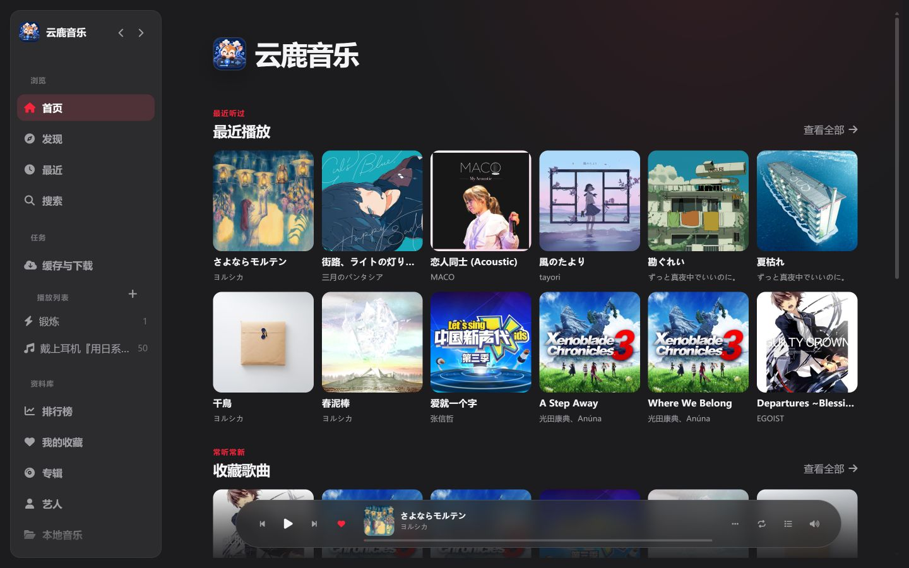
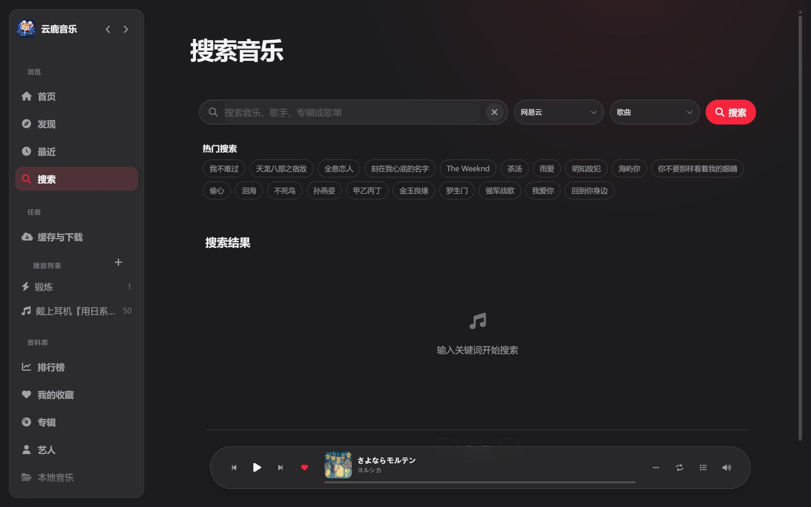
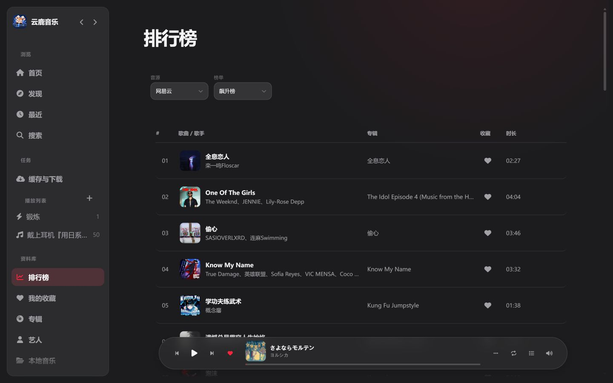
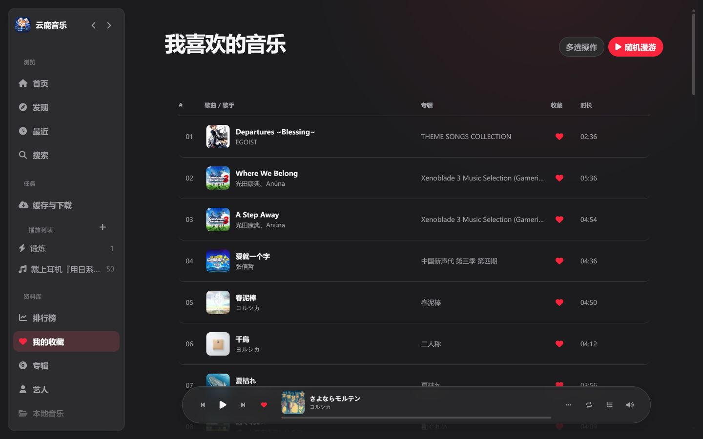
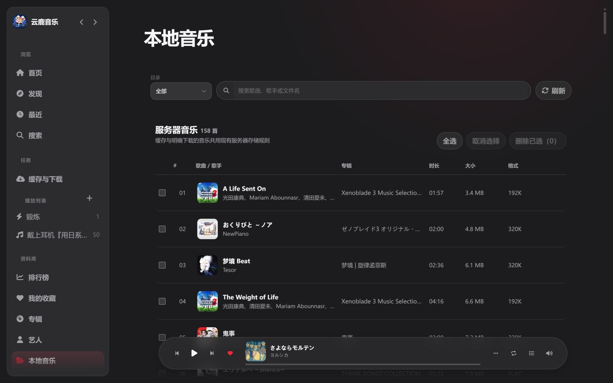
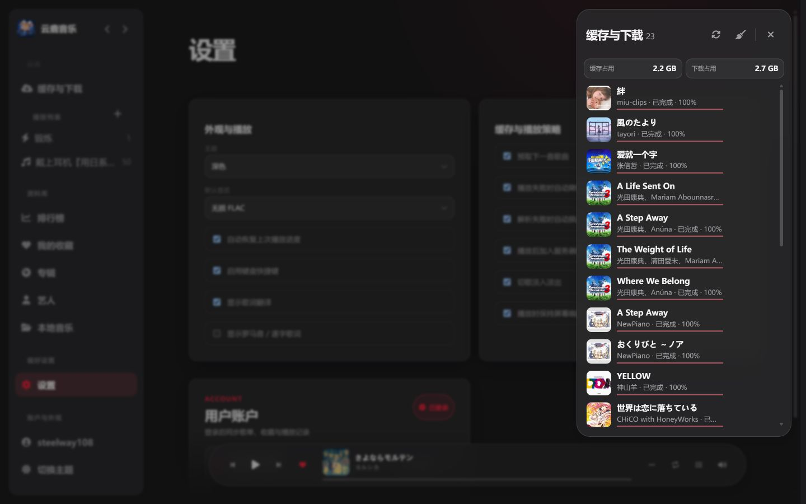
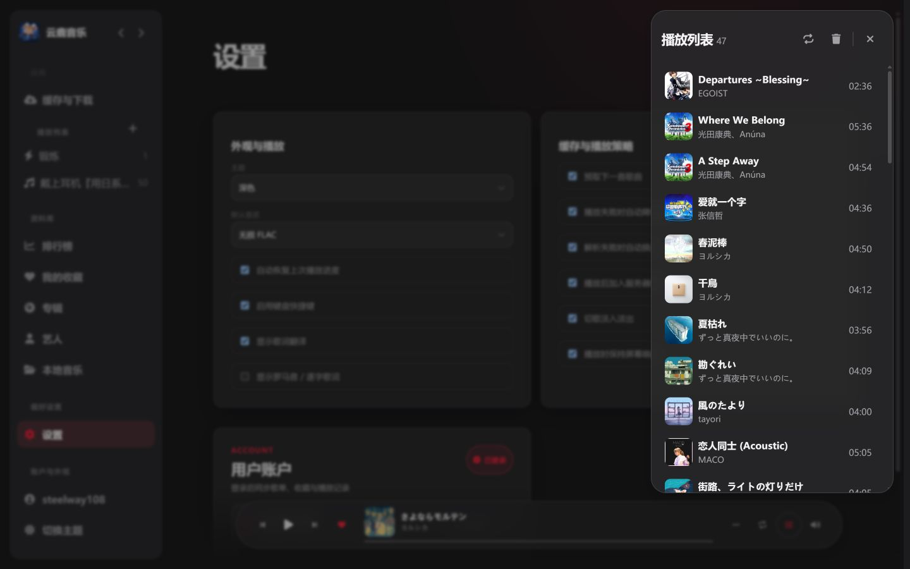

# 云鹿音乐

云鹿音乐是一套部署在自己服务器上的 Web 音乐播放器。打开浏览器即可搜索并播放音乐、查看歌词、整理歌单与收藏，也可以访问服务器上的本地音乐；管理员通过配套后台管理账户、音源与实例设置。

播放器和管理后台作为同一个实例运行，账户与播放数据由实例保存。项目当前面向浏览器使用，不提供旧版 LX 客户端同步、WebSocket 同步、Subsonic / OpenSubsonic 或 WebDAV 服务。

## 产品界面

以下为已部署 Web 播放器的真实页面截图。桌面页面保留左侧功能导航和底部播放器；播放列表、下载任务以侧边面板呈现，歌词页提供独立的沉浸式视图。



| 发现歌单 | 音乐搜索 |
| --- | --- |
|  |  |

| 排行榜 | 我的收藏 |
| --- | --- |
|  |  |

| 服务器本地音乐 | 缓存与下载 |
| --- | --- |
|  |  |

| 播放队列 | 沉浸式歌词 |
| --- | --- |
|  |  |

## 听音乐与管理资料

- **搜索与播放**：在已分配且启用的音源中搜索歌曲，在线播放并查看歌词。
- **整理个人音乐**：维护歌单、收藏、最近播放与播放队列。
- **本地音乐**：播放服务器上的本地音乐，并管理主动下载到本地库的歌曲。
- **管理实例**：在管理后台维护用户、音源、配置、快照、本地备份、日志和服务状态。
- **自托管**：使用 Docker Compose 部署，数据目录由你选择和管理。

## 部署

准备 Docker Compose 文件：

```yaml
services:
  yun-yin:
    image: ghcr.io/biaobiaobiao108/yun-music:latest
    container_name: yun-yin
    user: "${PUID:-1000}:${PGID:-1000}"
    restart: always
    ports:
      - "9527:9527"
    volumes:
      - ./data:/server/data
      - ./cache:/server/cache
      - ./music:/server/music
      - ./cover_cache:/server/cover_cache
    environment:
      NODE_ENV: production
      FRONTEND_PASSWORD: replace-with-a-strong-admin-password
      LX_USER_admin: replace-with-a-strong-user-password
```

启动服务并查看日志：

```bash
docker compose up -d
docker compose logs -f yun-yin
```

访问地址：

- 播放器：`http://服务器地址:9527/music`
- 管理后台：`http://服务器地址:9527/`
- 健康检查：`http://服务器地址:9527/healthz`

`FRONTEND_PASSWORD` 是必填的管理员密码，请替换成高强度随机值。`LX_USER_admin` 会创建初始播放器账户，同样应换成独立的强密码。容器默认以 `bun` 用户运行，UID/GID 为 `1000:1000`；Compose 中的 `user` 设置会覆盖镜像默认身份。需要使用其他宿主机 UID/GID 时，可在 `.env` 中设置 `PUID` 和 `PGID`，并按对应 UID 调整挂载目录属主。生产环境建议经由 HTTPS 反向代理访问。

启用全局出站代理时，经过远程 URL 安全校验的域名只有在本机 DNS 返回纯 fake-IP 地址时才会交给代理解析；若返回普通 DNS 地址，请求会失败，因为代理可能将同一域名解析到未校验的内网地址。公网 IP 字面量仍可经代理请求；直接返回私网地址或混合 fake-IP 与普通地址的 DNS 结果会被拒绝。需要通过代理访问域名时，请使用 fake-IP DNS；否则关闭全局代理。

### 挂载目录权限

首次部署前，或从 root 运行切换到 `bun` 用户后，确保 Compose 项目目录下的 `data/`、`cache/`、`music/` 和 `cover_cache/` 对容器 UID 可读写。已有文件通常需要一并调整属主。下面以默认 UID 1000 为例；如果设置了自定义 `PUID`，请将命令中的 `1000` 替换为该值。已有容器先执行停服命令；首次部署时跳过该命令。操作保留现有组属主，不要使用 `chmod 777`：

```bash
docker compose stop yun-yin
mkdir -p ./data ./cache ./music ./cover_cache
sudo chown -R 1000 ./data ./cache ./music ./cover_cache
sudo chmod -R u+rwX ./data ./cache ./music ./cover_cache
docker compose up -d yun-yin
```

在 NAS 上通过 SSH 执行时，将四个相对目录替换为实际挂载路径下的 `data`、`cache`、`music` 和 `cover_cache`。权限调整后，可确认容器身份及关键目录可写：

```bash
docker compose exec yun-yin id
docker compose exec yun-yin sh -c 'test -r /server/data/config.js && test -w /server/data/config.js && test -w /server/data/yun-yin.db && test -w /server/cache && test -w /server/music && test -w /server/cover_cache'
```

第二条命令成功退出（无错误输出）表示检查通过。如果 NAS ACL 限制导致 `chown` 失败或检查不通过，请在 NAS 的权限管理界面为对应 UID 授予目录遍历、文件读取和写入权限；同时确保 Docker bind mount 本身以读写方式挂载。

## 数据由你保存

Compose 将应用数据分别挂载到宿主机目录，便于按需备份或迁移：

| 目录 | 内容 |
| --- | --- |
| `data/` | SQLite 数据库与实例配置 |
| `cache/` | 可重新获取的播放缓存与歌词 |
| `music/` | 主动下载或整理的本地音乐，不受缓存清理策略影响 |
| `cover_cache/` | 封面缓存 |

用户、会话、设置、歌单/黑名单快照元数据和缓存索引保存在 SQLite 中。密码以 scrypt 哈希保存；浏览器认证使用 HttpOnly、SameSite Cookie。备份和实例目录应放在受控位置，不要公开数据库、配置、会话 Cookie 或日志。

服务端在启动时按容器内存限额安排工作额度。未设置限额时，上游缓冲请求最多同时执行 4 个，共享 64 MiB 估算缓冲预算（包含原始字节、拼接与解析开销），等待队列最多 32 个、等待最多 15 秒；实际并发还受每次请求预留大小限制。单个上游响应上限会按可用预算收紧。主动下载全局最多 4 个，与媒体中继共用最多 8 个传输名额；后台缓存仍最多 1 个，标签后处理仍最多 1 个。容器限额不超过 256 MiB 时，对应并发收紧为 2 个缓冲请求、2 个下载、4 个媒体传输。

音源匹配、歌手、通用数据、索引与静态压缩结果的常驻缓存合计最多约 32 MiB，较小容器按其限额的八分之一收紧；额度不足时淘汰缓存或跳过缓存，不删除数据库与歌曲。缓冲预算和缓存字节数是应用层估算，不代表进程 RSS 的硬上限。管理员 `GET /api/status` 可查看 `resourceBudgets`、`memoryCaches`、进程 RSS、swap 和 GC 软阈值。

GC 在任务结束后延迟检查，只有内存压力伴随一定规模的 JS 堆或外部缓冲时才执行；重型任务繁忙时推迟，低收益时从 30 秒逐步退避到最多 5 分钟。NAS 上还应区分文件页缓存、进程换出页与 zswap，不应只凭容器总占用判断泄漏。

## 当前产品范围

云鹿音乐当前提供浏览器播放器和管理后台。旧的 LX 设备同步、Subsonic / OpenSubsonic、WebDAV、同步 Token 和旧密码请求头接口已移除，不要将本项目配置为这些旧客户端或协议的服务端。

## 从源码运行

需要 Bun 1.4.3 或更新版本：

```bash
bun install
bun run build:frontend
bun start
```

开发时可以运行：

```bash
bun run dev
bun run dev:frontend
```

前端源码位于 `frontend/`，由 Bun Bundler 编译到 `public/`。播放器和管理后台使用 React、TypeScript 与 Zustand，服务端使用 Bun、TypeScript 和 `bun:sqlite`。

HTML 入口、Service Worker 和 JavaScript 包由构建脚本生成，不纳入 Git 跟踪；请修改 `frontend/` 中的源模板。`bun run dev` 和 `bun start` 会先构建前端，Docker 构建也会生成这些资源。新检出项目运行测试前，请先执行 `bun run build:frontend`。

## 许可证

本项目基于 [Apache-2.0 License](./LICENSE) 协议分发。
